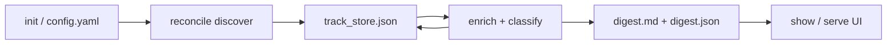

# Status Overlook — agent context (handoff)

Use this doc when opening the **status-overlook** repo in Cursor. It summarizes product intent, architecture, locked decisions, shipped phases, and recent work so you can continue without re-deriving context from chat history.

**Canonical references (prefer these over this file when details matter):**

| Doc | Purpose |
|-----|---------|
| [README.md](../README.md) | Install, CLI, paths, capabilities |
| [docs/DECISIONS.md](DECISIONS.md) | Locked classification + grouping rules |
| [docs/CONFIG.md](CONFIG.md) | Paths, Jira blocked, Review+PR, UI, GitHub Issues |
| [docs/SUCCESS.md](SUCCESS.md) | Phase checklist (0–6) |
| [skills/status-overlook/SKILL.md](../skills/status-overlook/SKILL.md) | How *consumers* (agents in other repos) read digests |
| [.cursor/skills/status-overlook-dev/SKILL.md](../.cursor/skills/status-overlook-dev/SKILL.md) | Implementation skill (this repo in Cursor) |
| [.cursor/rules/agent-context.mdc](../.cursor/rules/agent-context.mdc) | Always-on Cursor rule (condensed invariants) |

---

## What this project is

**Status Overlook** is a **personal, local-first** CLI that answers: *what Jira + GitHub work needs me right now?*

- **Not** a team board, Slack bot, or write-back integration.
- **Agent contract:** local `digest.md` / `digest.json` (or `status-overlook show --plain`) — not the browser UI.
- **Data plane:** `gh` + `acli` only (no direct REST SDKs in v1).
- **Repo:** https://github.com/danreed-rh/status-overlook  
- **Dev checkout:** `/Users/dareed/Dev/status-overlook`  
- **Version:** `0.2.0` (see `pyproject.toml`)

Owner: Dan Reed (`danreed-rh`). Primary Jira site: `redhat.atlassian.net`.

---

## Product shape (pipeline)



**`status-overlook run`** = reconcile (if not skipped) → enrich/classify → save store → write digests.

| Stage | Module | Role |
|-------|--------|------|
| Discover | `providers/jira.py`, `providers/github.py` | Build `Candidate` list from `acli` / `gh search` |
| Merge | `store.reconcile` | Add/refresh/finish/prune tracked items |
| Enrich | `enrich.py` | Fetch live fields; build snapshots |
| Classify | `classify_jira.py`, `classify_github.py`, `classify_github_issue.py` | Pure rules → `action` + `lifecycle` |
| Cue | `cues.py` | Present-time next-action / blocked-reason labels from `reasons` |
| Present | `digest.py`, `term_show.py`, `serve.py` | Markdown, JSON, terminal, localhost UI |

**Two timestamps (do not conflate):**

| Field | Meaning |
|-------|---------|
| `state_changed_at` | Last time *our* derived state changed (action, blocked, remote status, reasons). No-op runs must not bump it. |
| `last_read_at` | User/agent mark-read; unread = `state_changed_at` after this |

---

## Three sources (IDs must not collide)

| Source | `source` value | Store id prefix | Discovery |
|--------|----------------|-----------------|-----------|
| Jira | `jira` | `jira:KEY` | `acli` assigned + QA-in-Testing |
| GitHub PR | `github_pr` | `github-pr:owner/repo#n` | `gh search prs` author **or** assignee |
| GitHub Issue | `github_issue` | `github-issue:owner/repo#n` | `gh search issues --assignee=@me … is:issue` **only** (not author) |

**Legacy migration:** old stores used `source=github` and `github:…` for PRs. `store.normalize_*` migrates to `github_pr` / `github-pr:…` on load (`tests/test_store_migrate.py`).

**Pins:** `pins.github` → PRs; `pins.github_issues` → issues. `skip_github` skips **both** PRs and issues.

---

## Action states

`actionable` | `pending` | `blocked` | `done` | `ignore`

Show/digest section order: **Actionable → Pending → Blocked → Recently done**.

**Cues** (display-only, not action states): `cues.cue_for(action, reasons)` maps reason codes to a next-step / blocked-reason label (`Review`, `Waiting for review`, `Blocked by issue`, …). Shown on UI pills, `show`, and `digest.md`. `digest.json` has both `cue` `{id,label,kind}` and raw `reasons`. Not stored; does not bump `state_changed_at`. Group cue comes from the primary. See [DECISIONS.md](DECISIONS.md).

### Jira (high level)

- **Blocked:** status `Blocked`, label `blocked`, Flagged, or unresolved *is blocked by* link (`acli view` for issuelinks — search rejects that field).
- **Review + assignee:** pending; **Review + merged PR** (`pr_link_field`) → actionable (`jira_review_pr_merged`).
- **Epic:** pending until all children terminal; `[Epic]` tag; sort to bottom of active sections.
- **Testing + QA contact:** actionable; Testing + assignee only → ignore.

### GitHub PR (high level)

- **Author:** actionable if unresolved inline review threads, CI fail, draft, or ready label (`lgtm`); else pending.
- **Assignee (not author):** pending if *your* unresolved review threads or you gave lgtm; else actionable (needs your review).
- **Linked Jira blocked** → PR blocked.

**Important fix (Aug 2026):** `has_unresolved_reviews` is set from GraphQL `reviewThreads` (any unresolved), not only `reviewDecision=CHANGES_REQUESTED`. Example: PR #8787 was `REVIEW_REQUIRED` with open threads but classified as `pending` until this was fixed (`probe_pr_review_threads` in `enrich.py`).

### GitHub Issue (high level)

- Closed → done; blocked label/Jira → blocked.
- Open + linked PR open → pending; merged linked PR → actionable.
- Open + assignee, no open linked PR → actionable.

Full rule tables: [DECISIONS.md](DECISIONS.md).

---

## Grouping (WorkGroup)

Active items collapse via union-find in `digest.build_work_groups`:

1. Jira `pr_link` → PR  
2. PR `linked_issue_ids` → Issue  
3. Jira key in PR/Issue title  
4. Section = best action (`actionable` > `pending` > `blocked`); primary = best-action member (open PR preferred); secondary `↔ …`  
5. Recently done **not** grouped  

JSON digest keeps flat items plus `group_primary_id` / `linked_ids`. Each item may include `cue` `{id, label, kind}` derived from `reasons`.

---

## Phased plan (all gates complete)

| Phase | Delivered |
|-------|-----------|
| 0 | Skeleton, paths, Apache-2.0 |
| 1 | Pure classification + unit tests |
| 2 | Reconcile via gh/acli |
| 3 | Enrich, digests, mark-read, blocked links, Review+merged PR |
| 4 | `init`, macOS LaunchAgent, uninstall |
| 5 | pipx/uv docs, Linux systemd + Windows Task Scheduler, README buckets, skill |
| 6 | `serve` localhost UI, views, filters, auto-refresh, dark a11y UI |

**Deferred (do not build without explicit ask):**

- Team multi-user / ROSA-hosted UI  
- Optional `ghd` provider (Q6)  
- Writing back to Jira/GitHub  
- Polling digests without `run` when OS scheduler updates (open UI stays stale until Refresh)  

Original phased plan lived in `my-cursor-claw` at `.cursor/plans/work_sync_phased_plan_2179a8ee.plan.md`.

---

## Local UI (`serve`)

```bash
/Users/dareed/Dev/status-overlook/.venv/bin/status-overlook serve --open
```

- **URL:** `http://127.0.0.1:8765/` (localhost only; `localhost` is rewritten to IPv4)  
- Static files: `src/status_overlook/web/{index.html,style.css,app.js}`  
- **Views:** Actionable, All active, **Everything** (active + done), Pending, Blocked, Recently done  
- **Source filters:** both, github (PRs+Issues), github_pr, github_issue, jira  
- **Auto-refresh:** runs full `run` pipeline; **skips** off-hours. Refresh now passes `force`. Reloads the list when a run finishes (not when OS scheduler alone updates disk)  
- **Prefs:** view/source/interval persisted in URL query + `localStorage`  
- **Theme:** follows `prefers-color-scheme` (light or dark). Cue pills; section headers name the bucket.  

Restart `serve` after editing static assets (or hard-refresh browser).

---

## Dev workflow

```bash
cd /Users/dareed/Dev/status-overlook
python3 -m venv .venv && source .venv/bin/activate
pip install -e ".[dev]"

.venv/bin/pytest tests/ -q
.venv/bin/status-overlook doctor
.venv/bin/status-overlook run
.venv/bin/status-overlook show --plain
```

**Owner machine paths (macOS):**

| Kind | Path |
|------|------|
| Config + store | `~/Library/Application Support/status-overlook/` |
| Digests | `~/Library/Caches/status-overlook/` |
| Logs | `~/Library/Logs/status-overlook/` |

**Tests:** unit tests; focus on classification, reconcile, digest grouping, provider mocks, serve payload. No network in default pytest.

**Style:** stdlib-first; PyYAML for config only; `http.server` for UI (no Flask). Minimize scope; match existing patterns in neighboring modules.

---

## Key modules (start here)

```
src/status_overlook/
  cli.py              # argparse entry
  run.py              # run_pipeline
  reconcile.py        # discover merge
  enrich.py           # gh/acli fetch, apply_classification, thread probe
  store.py            # TrackStore, TrackedItem, reconcile, migration
  digest.py           # markdown/json/ui digest, WorkGroup
  term_show.py        # colored terminal show
  serve.py            # localhost API + static
  classify_*.py         # pure rules (no I/O)
  cues.py               # reason → next-action / blocked cue (present-time)
  providers/
    jira.py           # acli search + QA query
    github.py         # fetch_open_prs, fetch_assigned_issues
  web/                # UI assets
```

---

## Recent implementation notes (Aug 2026)

These were built or fixed in Cursor sessions; useful when debugging “why doesn’t X show up?”:

1. **GitHub Issues** — Plan in `my-cursor-claw/.cursor/plans/github_issues_category_a93aa343.plan.md`. Was partially landed once (reconcile called `fetch_assigned_issues` but provider function missing). **Now wired:** discovery, enrich, classify, grouping, pins, UI filters.

2. **PR `github` → `github_pr` rename** — Symmetric with `github_issue`; legacy store migration on load.

3. **Dark UI + Everything view** — Plan: `dark_ui_ux_polish_6f3e72d2.plan.md`. `view=everything` adds Recently done section. Serve process must be **restarted** after Python changes to `build_ui_digest`.

4. **PR #8787 / unresolved threads** — Authors stay actionable while **any** review thread is unresolved (GraphQL), not only formal CHANGES_REQUESTED.

5. **Wrong-repo chat** — GitHub Issues prompts were accidentally run in `openshell-dashboard` Cursor window; no automatic chat transfer between workspaces. Copy plan or this doc into status-overlook.

---

## Common pitfalls

| Symptom | Likely cause |
|---------|----------------|
| Issue not in digest | Not discovered (`assignee:@me` only); run `status-overlook run`; check `track_store.json` |
| UI missing new view/section | Stale `serve` process — restart |
| Dropdown prefs reset on reload | Fixed: URL + localStorage in `app.js` |
| `run` crashes on reconcile | Missing provider function or import error — run pytest |
| Jira items marked done after `run --skip-jira` | Reconcile finishes items absent from candidate set — use full `run` to restore |
| Grouped row “wrong” primary | Open PR wins tie-break; check `build_work_groups` / `_pair_edges` |

---

## Suggested next work (not scheduled)

Pick based on user ask; none are required for v0.2.0:

- Tag/release `0.2.1` after GitHub Issues + thread fix land in git  
- UI: poll digest file without full `run` when scheduler updates in background  
- `ghd` provider (deferred Q6)  
- Repo allowlists / org filters  
- Human Gate 5 smoke on a real Linux VM and Windows PC — [SMOKE.md](SMOKE.md)  

---

## Cursor setup in this repo

1. Open folder: `/Users/dareed/Dev/status-overlook`  
2. Always-on rule: `.cursor/rules/agent-context.mdc` (condensed invariants; read before substantive edits).  
3. Full handoff: `@docs/AGENT_CONTEXT.md` or `.cursor/skills/status-overlook-dev/SKILL.md`.  
4. Optional: install `skills/status-overlook/` into `~/.agents/skills/` for *consuming* digests from **other** repos (this repo *implements* the tool).  
5. Do **not** confuse with `my-cursor-claw` (personal todos/productivity) — that repo may reference Status Overlook but is not the implementation home.

---

*Last updated: 2026-08-27 — Linux/Windows onboarding, portable contrib templates, UI light/dark + off-hours Refresh now.*
